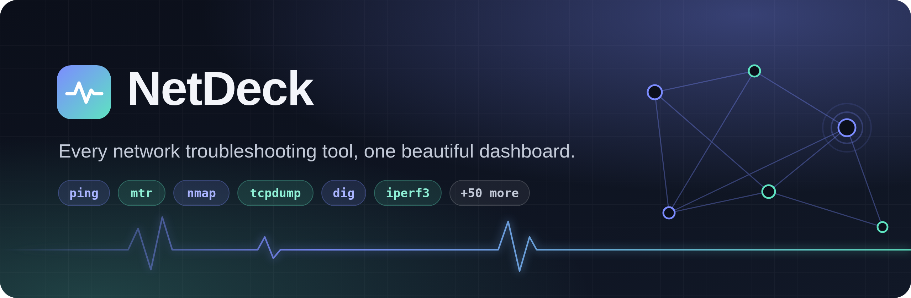
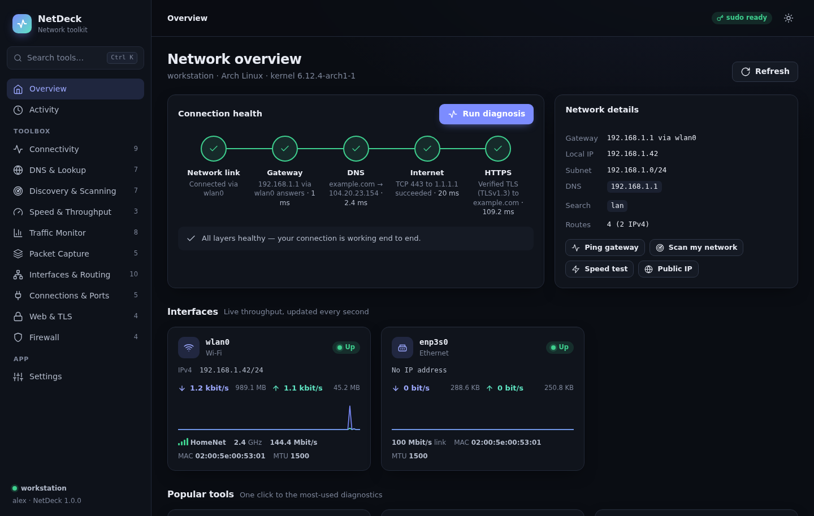
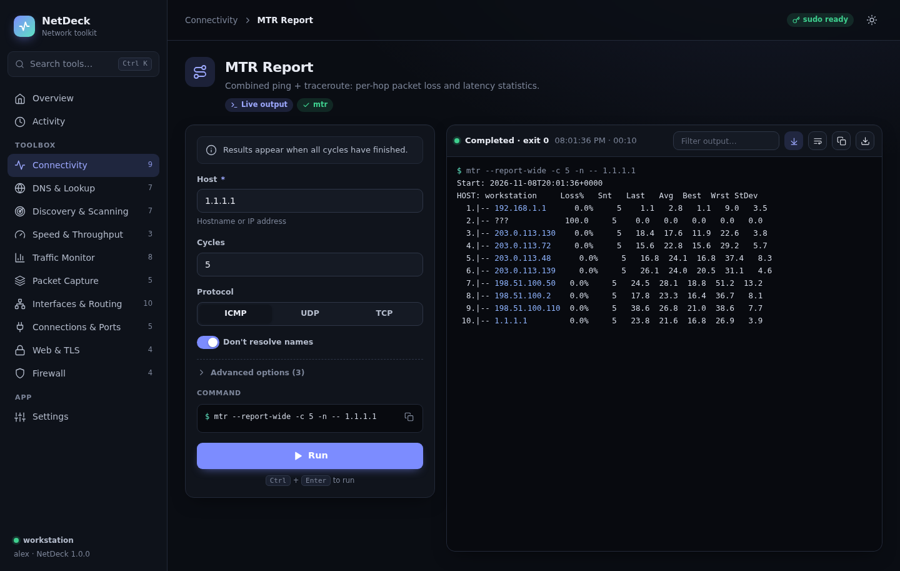
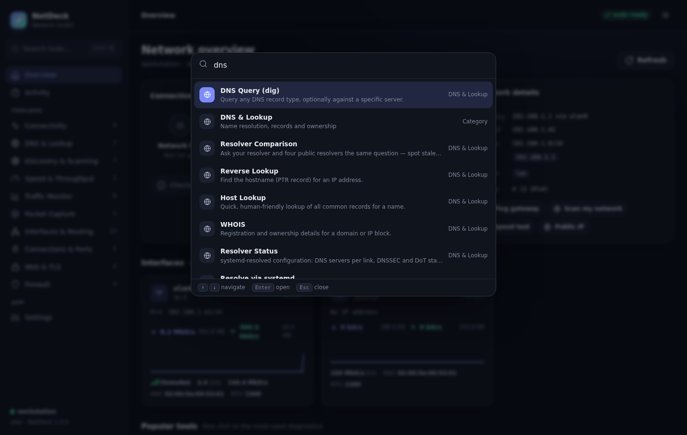
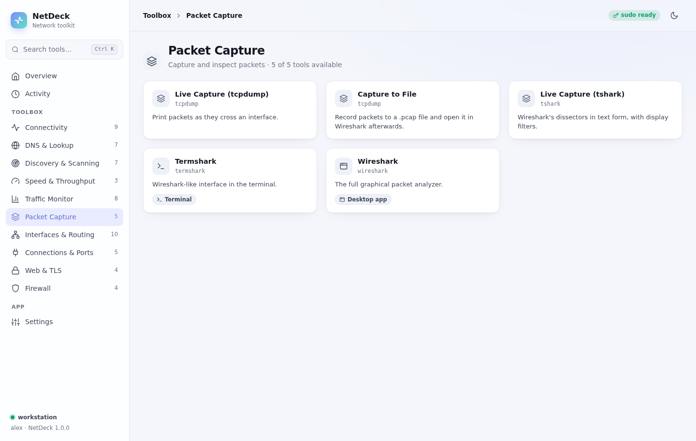
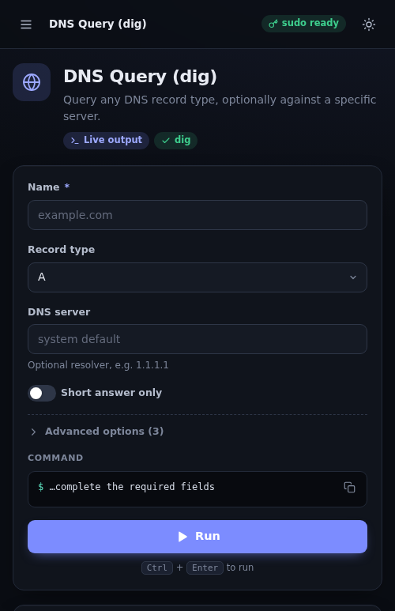

<div align="center">



<br>

[](https://github.com/randynorthrup/netdeck/actions/workflows/ci.yml)
[](pyproject.toml)
[](pyproject.toml)
[](#install)
[](LICENSE)

[](#tools)
[](https://github.com/astral-sh/ruff)
[](CONTRIBUTING.md)
[](https://github.com/randynorthrup/netdeck/commits/main)
[](https://github.com/randynorthrup/netdeck/stargazers)

### Ping, trace, scan, capture, measure and inspect — from one fast local web UI instead of a dozen terminal windows.

[**Install**](#install) · [**Features**](#why-netdeck) · [**Tools**](#tools) · [**Security**](#security) · [**Docs**](docs/ARCHITECTURE.md) · [**Contributing**](CONTRIBUTING.md)

<br>



</div>

---

## Why NetDeck?

Linux already has world-class network tools — `mtr`, `nmap`, `tcpdump`, `dig`, `iperf3`, `ss` and friends — but each has its own flags, output format and privilege quirks. NetDeck puts **60+ tool workflows in 10 clear categories** behind a consistent, keyboard-friendly interface, while showing you the exact command it runs so you learn as you go.

- **One-click connection diagnosis** — checks link → gateway → DNS → internet → HTTPS and tells you which layer is broken.
- **Live overview** — every interface with addresses, Wi-Fi signal, link speed and real-time throughput graphs.
- **Guided forms** — sensible defaults, validated inputs, interface pickers and your gateway / subnet prefilled.
- **Live streaming output** — colour-highlighted IPs, latencies and errors; filter, copy, download, stop.
- **Transparent** — every run shows the exact command line. Copy it and use it anywhere.
- **Terminal and desktop apps too** — interactive tools (`nmtui`, `bmon`, `iftop`, `termshark`, `trippy`) open in your terminal; GUI tools (Wireshark, Zenmap, Sniffnet) launch with one click.
- **Command palette** — <kbd>Ctrl</kbd>+<kbd>K</kbd> to jump to any tool by name, purpose or keyword ("who is on my network", "ssl expiry").
- **Secure by design** — localhost-only, token-authenticated, no shell anywhere, strict input validation. See [Security](#security).
- **Zero dependencies** — pure Python standard library and vanilla JS. No Node, no CDN, works fully offline.
- **Dark & light themes**, accent colours, responsive down to phone width.

<table>
<tr>
<td width="50%"></td>
<td width="50%"></td>
</tr>
<tr>
<td></td>
<td align="center"></td>
</tr>
</table>

## Install

**Requirements:** Linux, Python 3.10+. Tools are optional — NetDeck shows what's missing and the exact command to install it.

### One-liner

```bash
curl -fsSL https://raw.githubusercontent.com/randynorthrup/netdeck/main/scripts/install.sh | bash
```

### From a clone

```bash
git clone https://github.com/randynorthrup/netdeck.git
cd netdeck
./scripts/install.sh --with-tools     # --with-tools also installs the network tools
```

| Option | What it does |
| --- | --- |
| `--with-tools` | Installs the network tools with your package manager (pacman, apt, dnf, zypper) |
| `--service` | Starts NetDeck automatically at login (systemd user service) |
| `--system` | Installs for all users under `/opt/netdeck` (requires sudo) |
| `-y` | Don't prompt during package installation |

The installer creates an isolated virtualenv, a `netdeck` command in `~/.local/bin`, and an application-menu launcher.

### With pipx

```bash
pipx install git+https://github.com/randynorthrup/netdeck.git
```

## Usage

```bash
netdeck            # start (or re-open) the dashboard
netdeck doctor     # which tools are installed, and how to install the rest
netdeck url        # print the private URL of the running instance
netdeck stop       # stop the running instance
```

NetDeck opens in a chromeless app window when Chrome/Chromium/Brave is available, otherwise in your default browser. Running `netdeck` again simply re-opens the existing instance.

**Keyboard shortcuts:** <kbd>Ctrl</kbd>+<kbd>K</kbd> or <kbd>/</kbd> search · <kbd>Ctrl</kbd>+<kbd>Enter</kbd> run the current tool · <kbd>Esc</kbd> close.

## Tools

| Category | Tools |
| --- | --- |
| **Connectivity** | Ping · TCP port check (built-in) · Traceroute (UDP/ICMP/TCP) · Tracepath · MTR report · MTR live · Graph ping (gping) · Trippy · ARP ping |
| **DNS & Lookup** | dig (any record, any server, +trace, DNSSEC) · Resolver comparison (system vs. Cloudflare/Google/Quad9/OpenDNS) · Reverse lookup · host · WHOIS · resolvectl status / query |
| **Discovery & Scanning** | Host discovery · Port scan (connect/SYN/UDP, service detection, scripts) · OS fingerprint · ARP scan · Neighbor table · Zenmap · Angry IP Scanner |
| **Speed & Throughput** | iperf3 client · iperf3 server · Internet speed test |
| **Traffic Monitor** | Bandwidth per process (nethogs) · Bandwidth per connection (iftop) · bmon · vnStat history · Interface counters · Sniffnet |
| **Packet Capture** | Live capture (tcpdump) · Capture to .pcap → open in Wireshark · tshark with display filters · Termshark · Wireshark |
| **Interfaces & Routing** | Addresses · Routing table · Route lookup · Link details · NetworkManager devices · Wi-Fi scan · Wi-Fi link · ethtool · nmtui · Connection editor |
| **Connections & Ports** | Listening ports · Active connections · Who uses this port? · Socket summary · TCP states |
| **Web & TLS** | HTTP headers · HTTP timing breakdown (DNS/connect/TLS/TTFB) · TLS certificate inspector (built-in) · Public IP |
| **Firewall** | nftables ruleset · iptables · UFW · firewalld |

Missing tools are shown greyed out with a one-click copyable install command for your distribution.

## Administrator access

Some tools (packet capture, SYN scans, firewall rules) need root. NetDeck **never runs as root itself**; it elevates individual commands:

1. **polkit (`pkexec`)** — a graphical password prompt per command (default on desktops).
2. **sudo** — used automatically when passwordless sudo is configured.
3. **Capabilities** — if a binary already has the needed file capabilities (Arch ships `nethogs`, `arp-scan` and `dumpcap` this way, and Wireshark's `wireshark` group grants capture rights), NetDeck runs it unprivileged.

Every elevated command is labelled in the UI before you run it. Details: [docs/PRIVILEGES.md](docs/PRIVILEGES.md).

## Security

NetDeck can run powerful tools, so the server is locked down:

- Listens on **127.0.0.1 only**; non-loopback binding requires an explicit `--allow-remote`.
- A **random 256-bit session token** per instance; the browser exchanges it for an `HttpOnly`, `SameSite=Strict` cookie.
- **Host-header allow-list** (defeats DNS rebinding) and **custom-header + Origin checks** on every state-changing request (defeats CSRF).
- **No shell, ever** — commands are argv lists; every parameter is validated by type (host, CIDR, port list, interface, URL…) and can never be interpreted as an option.
- Strict **Content-Security-Policy**, no third-party scripts, no telemetry. Tool output is rendered as text, never HTML.

Please report vulnerabilities privately — see [SECURITY.md](SECURITY.md).

## Configuration

Settings live in `~/.config/netdeck/config.json` and are editable from the **Settings** page:

```json
{
  "port": 8737,
  "privilege": "auto",
  "terminal": "auto",
  "app_window": true,
  "captures_dir": "~/netdeck-captures"
}
```

`privilege`: `auto` · `pkexec` · `sudo` · `none`. `terminal`: `auto` or a program name such as `kitty`, `ghostty`, `alacritty`, `foot`, `gnome-terminal`, `konsole`. Appearance (theme, accent, console size) is stored per browser.

## Uninstall

```bash
./scripts/uninstall.sh            # add --purge to remove settings too
```

## Development

```bash
make dev        # create .venv with dev tools
make run        # run from source with debug logging
make test       # pytest
make lint       # ruff + shellcheck + JS syntax check
```

Architecture overview: [docs/ARCHITECTURE.md](docs/ARCHITECTURE.md). Adding a tool is a single catalog entry: [docs/ADDING_TOOLS.md](docs/ADDING_TOOLS.md). Contributions welcome — see [CONTRIBUTING.md](CONTRIBUTING.md).

## Responsible use

Only scan, capture or probe networks and hosts you own or are explicitly authorised to test.

## License

[MIT](LICENSE) © 2026 Randy Northrup. The tools NetDeck drives are separate projects under their own licenses.
